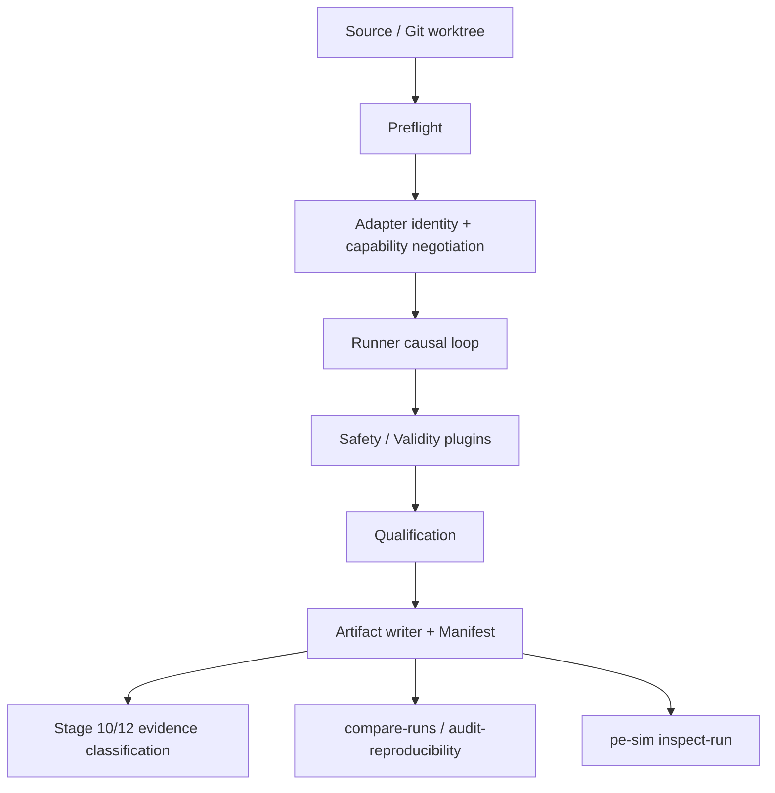

# Simulation Credibility Assurance (v0)

**Status:** design review, 2026-10-23; implementation update 2026-10-24. It
explains the current credibility chain, records verified gaps, and proposes
additive modules. The applicability layer and authenticity Level 1 are now
implemented; see `docs/40_validity_and_authenticity_v1.md`. It is not a
physical, thermal, hardware, or product claim.

## 1. Three different questions

"Credibility" mixes three questions that need separate answers:

| Question | Meaning | Current kernel |
| --- | --- | --- |
| Integrity | Is this package unchanged since publication? | Yes, locally: Manifest digest, package digest, artifact index, `PUBLISHED` marker, `pe-sim inspect-run`. |
| Provenance | Which source, environment, adapter, parameters, and contracts produced it? | Mostly yes: Git commit/worktree, environment, backend executable, component identity, implementation pin. |
| Validity | Is the model applicable to this operating point and this conclusion? | **Largely absent.** Qualification is structural only; there is no declared model envelope. |

A fourth question is often confused with integrity:

| Question | Meaning | Current kernel |
| --- | --- | --- |
| Authenticity | Was the package produced by a trusted writer, and has it been signed? | **Not provided.** A writer who can edit files can also recompute the public hashes. Git review, reviewed pins, and future signed releases are the anchors. |

## 2. Current credibility chain

### 2.1 Enforced by code (fail-closed)

- Experiment JSON is schema-validated before a run; unknown configuration and
  schedule keys are rejected.
- `plant_id`/backend mismatch, unknown backend, and adapter-class mismatch are
  rejected before the run directory is created.
- Formal comparison requires an explicit seed, non-placeholder contract
  hashes, a clean worktree, a complete source commit, complete Plant/Controller
  identity evidence, known environment provenance, known backend provenance,
  and (for pinned adapters) `implementation.review.status != "unreviewed"`.
- Capability negotiation rejects missing, unsupported, and mismatched
  capabilities.
- Non-finite actions/observations, timestamp regressions, future observations,
  stale observations, unit mismatches, and configured out-of-range values
  fail closed.
- Plugin exceptions become `checker_error`; a warning cannot silently upgrade
  a failing report.
- ngspice timeout, non-zero exit, missing/unparsable output, and convergence
  messages become structured failures.
- The switching Buck adapter rejects a control period that is not an integer
  multiple of the switching period, because the window netlist restarts the
  PWM carrier.
- The artifact writer requires its core files, validates the Manifest, and
  publishes by atomic directory rename.
- Stage 12 classification refuses `comparable`/`functional` conclusions for
  dirty, unknown, unqualified, or hash-incomplete provenance.

### 2.2 Recorded but not enforced

- Exploratory dirty runs can still be `QUALIFIED`; the dirty state is recorded
  and formal/Stage 12 gates reject it later.
- `plant.implementation.review.status` is recorded; only formal comparison
  rejects `unreviewed`.
- Backend provenance `partial`/`unavailable` is recorded; formal comparison and
  reproducibility gates decide what is acceptable.
- `qualification.json` records findings, but `BasicQualificationPlugin` only
  checks non-empty and finite samples.
- `manifest.evidence_level` is currently the fixed string `"functional"`, even
  for a dirty exploratory run. Stage 12 can downgrade it later, but the
  Manifest field itself is not derived from the actual provenance.
- Backend warnings on a successful solve are not classified; only the log
  digest is retained.
- Conformance checks (`pe_sim.conformance`) are available but are not linked to
  a run or to the reviewed identity pin.
- Comparison/reproducibility is opt-in and is not part of the run package.

### 2.3 Absent

- A declared model validity envelope: assumptions (for example CCM), operating
  ranges (Vin, Vout, load, duty, frequency, temperature), and numerical limits.
- Parameter provenance: where L, C, R, diode, switch, and control parameters
  came from, and their uncertainty.
- Qualification rules beyond structural validity: steady state, analytical
  equilibrium, energy balance, ripple, numerical health.
- A unified credibility assessment that aggregates provenance, review,
  qualification, and integrity into an explicit level.
- Per-signal comparison tolerances and time-grid alignment.
- A machine-readable review record with reviewer, date, acceptance IDs, and
  evidence references.
- Schema migration functions and a frozen public kernel surface.

## 3. Verified findings

| ID | Severity | Finding | Evidence | Status |
| --- | --- | --- | --- | --- |
| CRED-01 | High | No model validity envelope; a finite but physically inapplicable run can be `QUALIFIED`. | `checks.py` has finite/unit/range checks only; `reference_plants.py` declares no operating envelope. | Addressed in 0.5.0 (`model_claim.py`, `applicability.py`, docs/40 §2) |
| CRED-02 | High | Qualification is structural only. | `BasicQualificationPlugin` checks empty/non-finite samples; no steady-state, energy, or analytical rule. | Addressed as an opt-in standard pack (`qualification_rules.py`); CLI enables it by default |
| CRED-03 | Medium-High | Credibility factors are scattered and `manifest.evidence_level` is hardcoded `"functional"`. | `runtime.py` Manifest assembly. | Addressed: explicit `level`, `credibility.py`, derived `evidence_level` |
| CRED-04 | Medium | Comparison uses one absolute tolerance and index-based row alignment. | `reproducibility._numeric_differences`. | Addressed in 0.5.1 for the tolerance component (`ToleranceSpec`: absolute + relative + per-signal, digest recorded in the report, docs/41 §4). Index/time alignment remains open and is a prerequisite for UD-04. |
| CRED-05 | Medium | Successful solver warnings are not classified as numerical health. | `process.py` classifies fatal tokens only; successful logs are stored as a digest. | Addressed (`numerical_health.py`, bounded evidence in `plant.evidence`) |
| CRED-06 | Medium | Conformance evidence is not linked to a run or a review pin. | `conformance.py` exists; `reviewed_identities.json` has no acceptance IDs. | Partially addressed: review metadata added to the pin; conformance report hashing remains open |
| CRED-07 | Medium | No unified run lineage for resume, comparison, and derived products. | `recovery_provenance` is local; derived artifacts do not share a lineage record. | Open |
| CRED-08 | Medium | Integrity is not authenticity; a writer can recompute hashes. | `manifest_digest`/`package_digest` are public deterministic functions. | Addressed at L1 only (`attestation.py`); L2 signing is future work |
| CRED-09 | Low-Medium | `SafetyPlugin` Protocol declares only `check_observation`, while the Runner also calls `check_action`. | `checks.py` Protocol vs `runtime.py` action safety call. | Addressed: `check_action` added to the Protocol |
| COMPAT-01 | High for increments | ~~No schema migration registry~~ **Closed in 0.6.0:** `pe_sim.schema_registry` registers `0.1 -> 0.2` and the compatibility verdict fails closed without a path. | `contracts.py`, `schema_registry.py`. | Closed |
| COMPAT-02 | Medium | No frozen public kernel surface or deprecation policy for plugins/UI. | `pe_sim/__init__.py` exports many names without a stability statement. | Addressed in 0.5.1: `public_api.py` classifies stable (81) versus experimental (141) names and a frozen baseline fixture fails on any stable-surface change. Deprecation schedule is still absent and is deferred to 1.0 (docs/41 §2). |
| COMPAT-03 | Medium | No declared unit registry; units are checked only when a plugin is configured with expected units. | `ObservationValidityPlugin`. | Open |
| CRED-10 | High | `manifest_identity()` is producer-declared, so the formal gate trusted an adapter's own `review.status`. An object that reported `reviewed` was treated as reviewed. | `runtime._derive_evidence_level` / `_require_formal_evidence` read the recorded review block. | Addressed in 0.5.2: `identity.verify_adapter_identity` recomputes the digest, the pin lookup, and the declaring module, records the verdict at `plant.verification`, and all three consumers act on it (docs/42 §4). Consistency check, not a sandbox. |

### Fixed during this review

`reproducibility._manifest_identity()` included the whole `plant` mapping. The
new `plant.evidence` field (solver-invocation counts, first/last window
digests) would therefore make two runs with identical models compare as
different inputs. The identity now keeps only `id`, `hash`, and `identity`;
execution evidence is explicitly excluded. A regression test was added.

## 4. Proposed modules

All modules below are additive. They must not change the meaning of existing
required fields, and they must default to current behavior.

### 4.1 PreflightReport + PreflightPlugin

**Why:** `docs/06` describes a preflight gate, but the Runner writes no
preflight artifact. Successful gates are invisible; only failures surface as
exceptions.

**Shape:**

- `PreflightFinding` with `gate_id`, `status` (`pass`/`fail`/`not_applicable`),
  `severity`, `evidence`, `rule_version`.
- `PreflightReport` aggregated into `preflight.json`.
- `RunOptions(preflight_plugins=())` for project-local checks (model envelope,
  schedule ranges, output conflicts).
- `preflight.json` is **optional** in the artifact contract so old packages
  remain readable.

**Acceptance:** a reviewer can see every gate that was evaluated, including
schema, capability negotiation, source state, identity completeness,
implementation review, environment/backend provenance, and output checks.

### 4.2 CredibilityAssessment

**Why:** the factors exist but are not aggregated. `inspect-run` reports raw
facts; it does not state whether the package is credible for a stated purpose.

**Shape:**

- A fixed registry of factor IDs: `integrity`, `source_state`, `run_mode`,
  `environment`, `backend`, `plant_identity`, `implementation_review`,
  `qualification`, `safety`, `evidence_level`, optional `reproducibility`.
- Each factor returns `pass`/`limited`/`fail`/`unknown` plus evidence and a
  limitation string.
- Overall `status`: `credible`, `limited`, `not_credible`, `unknown`.
- Never a single numeric "score"; use explicit blocking findings and
  limitations.
- Read-only: consumed by `inspect-run`, `baseline-report`, future UI/agent.

**Acceptance:** `inspect-run` includes a `credibility` section; an exploratory
dirty run is `limited`, a clean formal run with known backend and reviewed
implementation is `credible`, and a tampered package is `not_credible`.

### 4.3 ModelClaim / ValidityEnvelope

**Why:** CRED-01 is the largest physics-credibility gap. `QUALIFIED` currently
means "structurally usable", not "the model is applicable here".

**Shape:**

- Optional `PlantAdapter.validity_envelope()` returning:
  - `assumptions`: CCM, ideal switch/diode, linear magnetics, no thermal state,
    etc.;
  - `operating_ranges`: Vin, Vout, load, duty, frequency, temperature;
  - `numerical_limits`: minimum samples per switching period, maximum step,
    convergence expectations;
  - `claim_level` and `limitations`.
- A `ModelEnvelopePlugin` checks the initial state, schedule, action, and
  external inputs. Policy per run: `record`, `warn`, or `enforce`.
- Default is `record` for exploratory runs and `enforce` for formal comparison.
- Out-of-envelope findings are structured and appear in `preflight.json` and
  `safety.json`.

**Acceptance:** a Buck averaged model run outside its declared CCM/load range
is at least `limited`, and a formal run is rejected or explicitly accepted by
policy.

### 4.4 ParameterProvenance

**Why:** parameters are recorded as numbers, not as reviewed decisions.

**Shape:**

- Optional `PlantAdapter.parameter_provenance()` returning records with
  `name`, `value`, `unit`, `source` (`datasheet`/`measurement`/`assumption`/
  `default`/`reviewed-reference`), `uncertainty`, `reference`, and
  `review_status`.
- Aggregate into a content hash and record it in the Manifest.
- Missing provenance is `unknown`, not an error.

**Acceptance:** `inspect-run` can list parameter sources; a run with only
`assumption` parameters is at most `limited` under the credibility policy.

### 4.5 QualificationRulePack + QualificationOutcome

**Why:** CRED-02. Structural checks are necessary but not sufficient.

**Shape:**

- Keep the existing `QualificationPlugin` protocol.
- Add a standard rule pack:
  - `SteadyStateRule`: windowed slope/ripple thresholds;
  - `AnalyticalEquilibriumRule`: uses an optional plant oracle (already present
    for Buck/Boost as `analytical_steady_state`);
  - `EnergyBalanceRule`: input/output energy within a declared tolerance when
    the required signals are declared;
  - `NumericalHealthRule`: consumes backend diagnostics.
- Add an additive `qualification.level` field: `full`, `limited`, `failed`.
  Existing `passed` remains for compatibility.
- `limited` means "usable for the declared purpose with listed limitations",
  not "physically validated".

**Acceptance:** a run with warning-only findings is `limited`, not silently
`QUALIFIED` in the same sense as a fully passing run.

### 4.6 NumericalHealth

**Why:** CRED-05. A successful solver run can contain recovered convergence
problems.

**Shape:**

- Parse the solver log for warning categories and counts (for example
  singular matrix, timestep reduction, gmin stepping).
- Record `numerical_health` in `plant.evidence`: warning categories, counts,
  and bounded excerpts; never the full log.
- Expose a factor to `CredibilityAssessment` and `NumericalHealthRule`.

**Acceptance:** a run with a recovered `timestep too small` warning is
`limited` and points to the log digest/excerpt.

### 4.7 TolerancePolicy

**Why:** CRED-04. One scalar absolute tolerance is not a credible comparison
policy for mixed units and solver noise.

**Shape:**

- `TolerancePolicy` with per-signal `absolute`, `relative`, or
  `absolute_or_relative` rules, ignored fields, and a time-alignment policy
  (`exact_grid`, `linear_interpolation`, `nearest`).
- Default policy reproduces the current `1e-9` absolute behavior, so existing
  tests and reports remain valid.
- Record the policy and its hash in the comparison report.

**Acceptance:** comparing voltage in volts and current in amps can use
different tolerances; a misaligned time grid produces an explicit
`not_comparable` reason instead of a row-index mismatch.

### 4.8 AdapterVerificationRecord

**Why:** CRED-06. A reviewed pin should reference the acceptance evidence that
justified the review.

**Shape:**

- Extend `reviewed_identities.json` with `reviewed_at`, `reviewer`,
  `acceptance_ids`, `conformance_report_sha256`, and `evidence_refs`.
- Optionally record the conformance report hash in the Manifest.
- Keep the pin readable if the extra fields are absent.

**Acceptance:** a reviewer can trace `implementation_sha256` to its
conformance checks and review record.

### 4.9 RunLineage and authenticity

**Why:** CRED-07/CRED-08. Derived products need a parent link; local hashes
prove integrity, not authorship.

**Shape:**

- `RunLineage` for resume, comparison, export, and re-analysis: parent run ID,
  checkpoint hash, derivation type, tool version, and input hashes.
- A future `ReleaseSignature` module (detached signature or external anchor)
  for authenticity. Do not describe an unsigned local package as authentic.

**Acceptance:** a resumed run and an exported derived artifact point to their
exact parent package; a release package can be verified against an external
signature.

### 4.10 ContractRegistry and kernel surface

**Why:** COMPAT-01/02. Incremental development needs versioned contracts, not
silent field changes.

**Shape:**

- A central registry of document schemas and versions with:
  - `current` version,
  - supported read range,
  - migration functions,
  - deprecation policy.
- A documented kernel surface: `ExperimentSpec`, `PlantAdapter`,
  `ControllerAdapter`, `RunOptions`, `run_experiment`, `CheckReport`, the
  Manifest/artifact contract, and the three visualization contracts.
- Everything else is explicitly internal but may be used with no stability
  promise.

**Acceptance:** an old run package remains readable after a schema increment;
a plugin/UI can depend on the documented surface without importing internals.

## 5. Recommended sequence

### Step 1: make the current logic explicit

Implement `PreflightReport` and `CredibilityAssessment` first. They are
read-only/additive, do not change physics, and immediately make every existing
credibility factor auditable. Integrate the assessment into `inspect-run`.

### Step 2: add physics applicability

Implement `ModelClaim`/`ValidityEnvelope`, `ParameterProvenance`, and the
standard `QualificationRulePack`. This is where "simulation credibility"
actually improves: a finite run is no longer automatically a meaningful run.

### Step 3: harden comparison and long-term compatibility

Implement `TolerancePolicy`, `AdapterVerificationRecord`, `RunLineage`, and
`ContractRegistry`. These protect incremental development and cross-run
conclusions.

### Step 4: release authenticity

Add signing/external anchoring when distribution justifies it. Until then,
state clearly that local hashes prove integrity, not authorship.

## 6. Compatibility rules for every new module

1. New adapter capabilities are optional methods with safe defaults.
2. New artifacts are optional; `ArtifactWriter.REQUIRED` must not grow without
   a migration plan for existing packages.
3. New Manifest fields are additive and optional; existing required fields keep
   their meaning.
4. New factors/rules have stable IDs and versions; unknown factors are
   `unknown`, not errors.
5. New enforcement is policy-driven and defaults to current behavior for
   exploratory runs.
6. New schema versions provide a migration function and a read range; old
   packages remain inspectable.
7. Comparisons and credibility assessments depend on model/parameter identity,
   never on execution evidence such as solver-call counts.

## 7. Non-claims

This document does not establish physical model validity, calibration,
thermal safety, hardware readiness, compliance, or product approval. A
`credible` assessment, if implemented, will remain a statement about the
recorded evidence and its declared limits, not about the real world.
