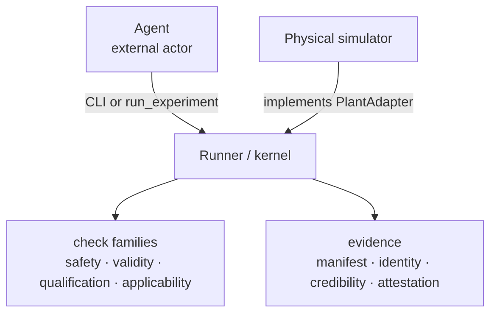

# Kernel Interface Topology v1

**Status:** assessment and adjustments in 0.5.2. This document answers one
question: *is the kernel shaped correctly for an interface-based plug-in model
covering both agents and physical simulators, and where is it redundant or
incomplete?*

**Related:** `docs/12_public_contracts_stage3_v1.md`,
`docs/15_runner_modular_api_v1.md`, `docs/37_user_discovery_backlog_v1.md`
(UD-04), `docs/41_kernel_compatibility_surface_v1.md`.

## 1. The topology that actually exists



Three facts determine the whole assessment:

1. **`PlantAdapter` already is the simulator interface.** Six methods
   (`contracts.py:393`): `capabilities`, `reset`, `observe`, `advance`,
   `snapshot`, `restore`. It says nothing about ngspice, netlists, or SPICE.
2. **The Runner is a dependency-injection host, not a factory.** `Runner.run`
   takes `plant: Any` and never compares a class name, module, or engine string.
   It asks only for protocol methods plus documented optional hooks
   (`manifest_identity`, `backend_evidence`, `validity_envelope`,
   `parameter_provenance`, `backend_provenance`, `action_policy`).
3. **Agents are clients, not plug-ins.** Agents reach the kernel through the CLI
   or the Python entry point. They never receive a mutation authority the kernel
   has to mediate.

So the *shape* is right. The defects are at the seams, and they are the subject
of §4-§6.

## 2. Decision: no `EngineAdapter` interface

A generic engine protocol (`probe` / `capabilities` / `solve`) is the obvious
thing to add, and it is **deliberately not added**.

Reason: the kernel only ever asks a plant for one thing — "advance this window
by `duration_s` and give me an observation". Engine invocation, netlist
construction, solver settings, and waveform parsing are internal to a simulator
adapter. Introducing `EngineAdapter` at the kernel boundary would either
duplicate `PlantAdapter` (two ways to say the same thing) or force every plant
to expose engine internals the kernel must not know about.

**Revisit when** either condition becomes true:

- the kernel must run a non-transient analysis itself (AC sweep, DC operating
  point, temperature sweep) and therefore must ask an engine what it supports;
- two different engines must back one plant id, making engine selection a
  runtime decision rather than a class decision.

Neither is true today; both belong to UD-04.

## 3. Decision: no `AgentAdapter` interface

Adding an agent plug-in protocol would create a **second trust path** next to the
one that already works (CLI/API + recorded evidence). It would also be
self-defeating: any actor field an agent writes about itself is self-reported and
therefore not a security control.

What the kernel owes an agent is different, and is delivered:

| Need | Mechanism |
| --- | --- |
| A surface the agent can program against without guessing | `public_api.py`, stable/experimental tiers (docs/41) |
| Evidence the agent cannot silently rewrite | manifest/package digests + detached attestation L1 (docs/40) |
| No self-certification | §4 below |
| A refusal that is explicit rather than silent | capability negotiation, applicability enforcement, formal gates |

## 4. Adjustment A: the kernel recomputes adapter identity

### 4.1 The defect

`manifest_identity()` is **producer-declared**. Whatever object is passed to the
Runner supplies its own `implementation.sha256` and `review.status`. Before
0.5.2, a formal-comparison gate read those fields and trusted them, so an object
that simply returned `{"review": {"status": "reviewed"}}` was treated as
reviewed. `inspect-run` could catch this after the fact only for backends it
knew about.

For an agent-produced adapter this is exactly the wrong invariant: the party
being checked supplies the evidence.

### 4.2 The check

`identity.verify_adapter_identity(component, identity)` recomputes instead of
trusting:

| Status | Meaning |
| --- | --- |
| `verified` | recorded digest == digest recomputed from disk, recorded review status == the kernel's own pin lookup, and the adapter's class is defined **inside** the declared solve path |
| `digest_mismatch` | the recorded digest contradicts the checkout |
| `review_status_mismatch` | the recorded review status contradicts the pin |
| `module_outside_solve_path` | the class that runs is not covered by the pin (a subclass defined elsewhere) |
| `unverifiable` | no `backend_id`, or no declared solve path — stated, not silently passed |

The verdict is recorded at `manifest.plant.verification`, **outside**
`plant.identity`, for the same reason execution evidence is kept outside it:
recomputing the same adapter must not look like a model change (regression test
`test_verification_is_not_part_of_the_identity_digest`).

Three consumers act on it:

- `_require_formal_evidence` rejects the three contradicted statuses;
- `_derive_evidence_level` requires `verified` before granting `comparable`;
- the `implementation_review` credibility factor returns `fail` on a
  contradiction and `limited` when a `reviewed` claim is `unverifiable`.

### 4.3 Honest limits

This is a **consistency check, not a sandbox**. A process that can rewrite
`identity.py` can rewrite the checker. It raises the bar from "the adapter says
so" to "the adapter's claim agrees with the files on disk", which is the
strongest statement a single-process design can make. Preventing the rewrite
requires the L2/L3 separation described in docs/40.

## 5. Adjustment B: the manifest contract contradicted the runtime

`schemas/manifest.schema.json` declared:

```json
"evidence_level": {"enum": ["mechanism", "functional", "physical-performance", "research-safety"]}
```

but `runtime._derive_evidence_level` writes `diagnostic_only`, `functional`,
`limited`, or `comparable`. **Three of the four were invalid**, including
`comparable` — the level a successful formal comparison exists to produce.

This was not cosmetic: `scripts/user_acceptance.py:849` validates published
manifests against that schema, so the shipped acceptance path would reject a
legitimate formal-comparison package.

The schema now declares the runtime vocabulary, and
`tests/test_manifest_evidence_level_contract.py` derives the values from
`_derive_evidence_level` rather than restating them, so the two cannot drift
apart again.

## 6. Adjustment C: one wiring table instead of four

The CLI previously encoded the same knowledge in four places: `_PLANT_BACKENDS`
(an identity map, `plant_id -> backend` with every value equal to its key),
`_BACKEND_CLASSES`, a schedule-key if/elif, and a build if/elif. They could
disagree, and a half-registered plant was a reachable state.

They are replaced by one `_PlantBinding` table carrying the backend id, the
expected class name, the accepted `input_schedule` keys, and the accepted
`plant_config` keys. The allow-list, the validation, and the constructor read
from the same row.

Third-party plants do **not** come through this table: they implement
`PlantAdapter` and are passed to `Runner.run` / `run_experiment` directly. The
table is a catalog of built-ins, not a kernel extension point, because a public
registration API with no discovery mechanism is a half-interface.

## 7. Redundancy register

Each item below was examined and kept. Removing them would break a stated
contract or change published behavior; they are recorded so they are not
re-discovered as defects.

| Redundancy | Verdict | Reason |
| --- | --- | --- |
| Legacy `safety_checker` / `qualification_checker` run alongside their plugin equivalents | Keep | They are stable public options (`RunOptions`); removing them needs a deprecation cycle, not a cleanup commit |
| Clean-worktree predicate in both `dirty.require_formal_comparison` and `_require_formal_evidence` | Keep | Different layers: early fail before any work, versus complete evidence check at manifest time (the second also checks the Git field, not only the analysis object) |
| `_require_formal_evidence` (reject) and `_derive_evidence_level` (rate) | Keep, with one shared truth | Same policy in two shapes is intentional; the shared truth is now `verification` |
| `credibility` re-reads source/environment while also consuming the recorded `evidence_level` | Keep | Different aggregation over the same facts; a package can be intact and still not credible |
| `evidence.classify_stage10` clean/known gate | Keep | Different artifact layer (Stage 10 summary), not the run manifest |
| `postprocess._ALLOWED_PLANT_CLASSES` | Keep | It is the restricted Stage 10 export policy, not a wiring table; widening it would widen an export boundary |
| Applicability checks are absent from the ordered audit stream | Keep | Deliberate: adding them would change the audit-order contract that docs/40 §2.3 pins |
| `PlantAdapter` and `BackendProvenanceAdapter` overlap on "what am I?" | Keep | One is the control interface, the other is optional provenance; merging would force every plant to answer provenance questions |

## 8. Missing, deliberately deferred

| Gap | Why not now | Trigger to build |
| --- | --- | --- |
| Engine capability declaration (transient / AC / temperature) | The kernel runs only transient windows; there is nothing to negotiate | First non-transient analysis the kernel executes itself |
| Plant discovery / `importlib.metadata` entry points | No external adapter exists to discover | UD-04, when a third party ships one |
| Engine-neutral `EngineAdapter` | See §2 | Two engines behind one plant id |
| Unit registry (COMPAT-03) | Units are checked where a plugin declares expectations | Multi-domain models (thermal, magnetic) |
| Schema migration registry (COMPAT-01) | No `0.2` schema has ever existed | First schema bump |
| Run lineage (CRED-07) | Resume/derived products are not implemented | First resume or derived-metric feature |
| Sample grid alignment | Positional alignment is correct for one fixed-step engine | First engine with a different time grid (UD-04) |

## 9. What this increment does and does not claim

- It claims the adapter contract is interface-shaped, the two seams that
  contradicted it are fixed, and a self-declared review can no longer pass
  formal comparison without corroboration.
- It does **not** claim the kernel supports multiple engines, that adapters are
  sandboxed, that any model is physically valid, or that an agent's behavior is
  constrained by anything other than the recorded evidence and the checks that
  consume it.
