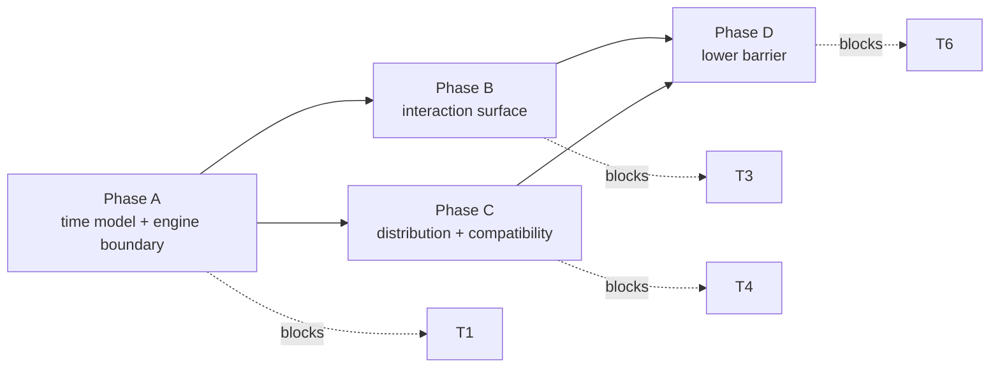

# Kernel Roadmap v1

**Status:** planning document, authoritative for sequencing.

**Authority.** This document decides *what order* work happens in and *what must
be true before moving on*. `docs/37_user_discovery_backlog_v1.md` remains a
user-discovery backlog (what users asked for) and is **not** a sequencing
authority. `docs/27_minimum_local_release_scope_v0.md` remains the release-claim
boundary. Contracts stay in `docs/01`-`docs/26`.

## 1. The target, restated as a test

The project goal is a kernel that keeps three logics - agent access, simulation
construction (circuit / simulator / algorithm), and data traceability - and can
grow into a packaged product with a lower barrier to entry.

That goal is only useful if it can be checked. The design must pass:

| # | Test | Today |
| --- | --- | --- |
| T1 | Add a physical engine by writing an adapter and registering it, with **zero** edits to kernel modules | fails |
| T2 | Add a topology without editing CLI allow-lists or schema enums | fails |
| T3 | An agent can discover capabilities, start, observe progress, cancel, and read evidence using only versioned contracts | fails |
| T4 | An installed release reads a package from an older release and states cross-version comparability honestly | fails |
| T5 | No self-declared or modified implementation can reach `comparable` | **passes** (0.5.2) |
| T6 | A user who does not read source can run, view, and verify | fails |

T5 is the property that makes the rest worth having, and it is the one that must
never regress.

## 2. Invariants every phase must preserve

| ID | Invariant |
| --- | --- |
| I1 | Constraints are enforced **during** the run, not reconstructed afterwards. A route that cannot do this must pay for it in evidence level (see §5). |
| I2 | Identity is recomputed by the kernel. Adapters may declare an identity; they may not certify one. |
| I3 | Published packages are immutable. Anything derived from a package carries a parent link. |
| I4 | New capability enters as `experimental`. Promoting a name to `stable` is a separate, reviewable event. |
| I5 | The kernel names no engine, topology, or vendor. |

## 3. Phases

**Current position:** Phase A, not started. It is blocked on decisions D1 and
D2 (§6). Everything shipped through 0.5.3 is groundwork covered by §4, not a
completed phase.

### Phase A - Time model and engine boundary

**Goal:** T1, and it unblocks T2.
**Why first:** the kernel currently owns the only possible time model. An
adapter must advance exactly to the requested endpoint, and comparison is
positional. Until that assumption is made explicit and optional, no engine
protocol can be designed honestly - it would either duplicate the current
adapter or quietly assume every engine is sliceable.

Work, at the level of commitments rather than code:

1. Decide who owns time, and record it in the decision ledger (§6, D1).
2. Declare the trace/cadence model as a contract: what a run produces and at
   what resolution.
3. Define the engine boundary: what the kernel asks of an engine, what an engine
   returns, and which guarantees form part of the answer.
4. Turn engine registration into data. The kernel stops enumerating engines in
   its own modules.
5. Attach a trust level to every adapter (reference / third-party / fixture) and
   record it in the run evidence.

**Gate G-A:** T1 passes for a second engine whose time behaviour differs from
the first, and the existing engine's evidence level is unchanged.
**Excluded:** implementing the second engine; choosing resampling parameters;
performance work.

### Phase B - Interaction surface

**Goal:** T3.
**Why after A:** the contracts an agent programs against must already have
stable meaning. Otherwise the agent surface encodes a design that is about to
change, and every agent client inherits the churn.

Work:

1. A versioned request -> progress -> terminal-result contract for a run.
2. Progress and cancellation as first-class behaviour. Today only a test hook
   exists, which is not something an external client can rely on.
3. A read-only query surface over produced packages, so a client never needs to
   know the directory layout.
4. The error taxonomy promoted from prose to contract: stable codes a client can
   branch on instead of matching message text.

**Gate G-B:** an external client can start a run, observe progress, cancel it,
and enumerate results using only documented contracts; nothing in this surface
can mutate a published package.
**Excluded:** UI; remote access; multi-user operation; authentication.

### Phase C - Distribution and compatibility

**Goal:** T4.
**Why here:** this only becomes structural once someone installs a release and
keeps packages produced by an earlier one.

Work:

1. Optional capabilities declared as install-time extras, so a packaged user can
   enable them without reading the repository.
2. Schema migration policy - read old, write new - with an explicit registry
   created at the first schema bump rather than retrofitted at the second.
3. A data-directory policy: the run store is user-scoped and discoverable,
   instead of ambient to whatever directory the process was started in.
4. Release gates extended from "this run is valid" to "this upgrade path is
   valid".

**Gate G-C:** install -> run -> upgrade -> an older package still verifies, and
its cross-version comparability is stated by the evidence rather than assumed.
**Excluded:** plugin marketplace; cloud sync.

### Phase D - Lower barrier

**Goal:** T6.
**Why last:** a user interface can only be honest about what Phases B and C
already expose.

Work: consumers built exclusively on Phase B contracts, distributed through
Phase C packaging. A consumer receives no Runner, Plant, Controller, or mutation
authority.

**Gate G-D:** T6 passes for a documented workflow, and the consumer holds no
authority beyond reading contracts.

## 4. Already sufficient - do not rebuild

These are complete for the stated goal. Re-deriving them would be cost without
new capability:

- **Evidence chain:** manifest/package/artifact digests, credibility factors,
  detached attestation with L1 anchoring, kernel-side adapter verification.
- **Public API tiers:** stable/experimental classification with a frozen
  baseline, so extension surfaces are declared rather than inferred.
- **Plugin contracts:** safety, validity, qualification, applicability, with
  per-plugin identity recorded in the manifest.
- **Reviewed-identity pins:** covering both the external-engine path and the
  native reference path.

## 5. Evidence pricing for integration routes

Phase A is not "accept every engine". It is "accept engines without silently
redefining what the evidence means".

| Integration route | In-run enforcement | Evidence level cap |
| --- | --- | --- |
| Stepped adapter (window advance) | full | `comparable` |
| Whole-run adapter (returns a trace) | post-hoc only | `limited` |
| Adapter whose implementation is not pinned | unknown | `limited` |
| Adapter that cannot declare a model envelope | unknown | `unknown` |

This table is the guard against the specific failure mode where "multi-engine
support" becomes true by making `comparable` mean less.

## 6. Decision ledger

Decisions are recorded here, with date and reasoning, **before** the phase that
depends on them starts. A phase does not begin on an unresolved decision.

| ID | Decision | Blocks | Status |
| --- | --- | --- | --- |
| D1 | Who owns time: kernel-stepped / engine-whole-run / dual with priced evidence | Phase A | **pending** |
| D2 | Third-party adapters run in-process or behind a process boundary | Phase A trust levels | **pending** |
| D3 | Run store root: working directory or user scope | Phase C | pending |
| D4 | Reading older packages: migrate on read, or read-with-policy | Phase C | pending |

D1 and D2 are prerequisites for Phase A. D3 and D4 may be decided later but
must be settled before Phase C starts.

## 7. Scope guard

Not kernel work, regardless of backlog position: new control algorithms,
tuning variants, new converter topologies, device/thermal models, dashboards,
and user interfaces. These are adapter or product content and may only enter
through the boundaries established in Phases A and D.

A backlog item is not a roadmap item. `docs/37` records what users asked for;
this document decides when it is allowed to consume kernel attention.

## 8. Definition of done for the whole goal

The goal is met when all of the following hold at the same time:

1. A new physical engine is onboarded by writing an adapter and registering it,
   with no kernel-module edits (T1).
2. A new topology is added by declaring it, with no allow-list or schema-enum
   edits (T2).
3. An external client performs the full lifecycle - discover, start, watch,
   cancel, enumerate, verify - through versioned contracts only (T3).
4. An installed release verifies packages produced by an earlier release and
   states the comparability limits itself (T4).
5. No adapter can reach `comparable` by asserting its own review status (T5).
6. A documented workflow lets a non-source-reading user run, view, and verify
   with no authority beyond reading contracts (T6).

If any invariant in §2 has to be weakened to reach these, that is a design
regression, not a schedule trade-off.

## 9. Relationship to existing documents

| Document | Role after this roadmap |
| --- | --- |
| `docs/01`, `docs/02` | Unchanged: contracts and artifacts |
| `docs/27` | Unchanged: release-claim boundary |
| `docs/37` | Backlog only. Its priority list is a user-impact ordering, **not** a work sequence |
| `docs/39`, `docs/40`, `docs/41`, `docs/42` | Unchanged: credibility model, validity/authenticity, compatibility surface, interface topology |
| `docs/43` (this file) | Sequencing, gates, invariants, decision ledger |
